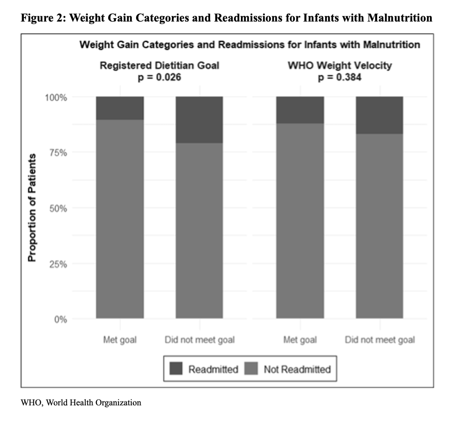

# Characteristics of Infants Hospitalized for Malnutrition and Factors Associated with Readmission  
### Phoenix Children’s Hospital | Presented at Grand Rounds (May 2025)

---

## Overview  
This hospital-based analysis explored **infants hospitalized for malnutrition**, comparing demographic and clinical features between those **readmitted within 90 days** and those with **single admissions**.  
The project was conducted to inform early-intervention strategies and quality-improvement (QI) initiatives aimed at reducing malnutrition-related readmissions.

> **Goal:** Identify predictors of 90-day readmission among infants hospitalized with malnutrition.

---

## Study Design  
**Type:** Retrospective chart review  
**Population:** 300 infants (0–12 months) admitted 2019 – 2024 with ICD-10 malnutrition codes  
**Inclusion:** Dietitian-confirmed malnutrition diagnosis, >72 h length of stay  
**Exclusion:** Palliative care, major surgical admissions, incomplete labs  
**Software:** SAS 9.4 and R (tidyverse, ggplot2)

---

## Methods  

| Step | Description |
|------|--------------|
| **Data Extraction** | Pulled demographics (age, sex, insurance), anthropometrics (z-scores), feeding route, LOS, comorbidities. |
| **Univariate Tests** | Wilcoxon rank-sum and Fisher’s exact tests (p < 0.05). |
| **Multivariable Modeling** | Logistic regression for readmission (Yes/No) adjusted for LOS, z-score, feeding type, and insurance. |
| **Visualization** | ggplot2 density plots for z-scores and bar plots for readmission rates. |

---

## Key Results  

| Variable | Readmitted (n = 45) | Not Readmitted (n = 255) | *p* value |
|-----------|--------------------|---------------------------|-----------|
| Median age (months) | 5 | 4 | 0.21 |
| Severe malnutrition (%) | 68 | 44 | 0.003 |
| Tube feeding (%) | 51 | 23 | 0.001 |
| Public insurance (%) | 76 | 49 | 0.005 |
| Median LOS (days) | 7 | 4 | 0.02 |

- **Severe malnutrition**, **enteral feeding**, and **public insurance** independently increased odds of readmission.  
- AUC of 0.78 for the multivariable model indicated good discrimination.  

---

## Visuals  

  

---

## Interpretation  
- Infants with greater malnutrition severity and complex feeding needs had higher readmission risk.  
- Insurance type may reflect socioeconomic determinants of nutrition recovery.  
- Findings guided creation of a PCH nutrition follow-up workflow to target high-risk discharges.

---

## Skills Demonstrated  
Hospital EHR data management • Regression modeling • Public health reporting • Visualization with R • Clinical quality-improvement analytics  

---

## 🔗 Citation / Presentation  

**Characteristics of Infants Hospitalized for Malnutrition and Factors Associated with Readmission**  
Presented at **Phoenix Children’s Grand Rounds** · May 20, 2025 — [Event details](https://phoenixchildrens.org/healthcare-professionals/continuing-medical-education/pch-hot-topics-pediatric-hospital-medicine-bethany-farretta-md-roxana-guggenmos-do-and-emily-manion)

**Authors:**  
Emily B. Manion, MD¹; Nehal Thakkar, MD MBA²˒³; Peggy Fullenkamp Oomens, MS RDN CNSC CSP²; John Hartley, DO²˒³; Krisha Mansukhani, MS²; Lucia Mirea, PhD²˒³; Reina Patel, DO²˒³; Sandra Gage, MD PhD²˒³; Brittany Wold, MD²˒³  

**Affiliations:**  
¹ Vanderbilt University Medical Center, Nashville, TN  
² Phoenix Children’s, Phoenix, AZ  
³ University of Arizona College of Medicine – Phoenix, Phoenix, AZ  